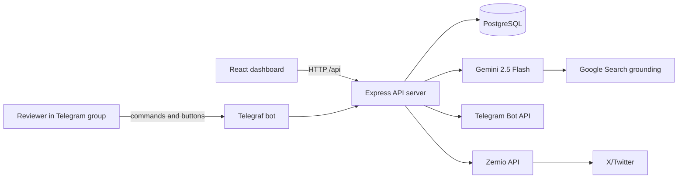

# AI Social Media Manager — Project Documentation

## 1. Project overview

The AI Social Media Manager is a single-user social-media command center for
creating, reviewing, approving, and publishing content to X/Twitter.

The application combines:

- A React dashboard for managing content, keywords, settings, and analytics.
- An Express API server for business logic and integrations.
- PostgreSQL for persistent content and configuration data.
- Gemini 2.5 Flash for content generation.
- Gemini Google Search grounding for trend-aware content generation.
- Telegram for human approval before publishing.
- Zernio for publishing approved content to an X/Twitter account.
- A background scheduler for optional automatic content generation.

The central product decision is **human-in-the-loop publishing**:
AI can propose content, but content is not published until a person approves it
from the dashboard or Telegram.

## 2. What the product does

### Manual generation

An operator can generate:

- Tweets
- Replies
- Content ideas

The operator chooses a topic or leaves the topic blank. When the topic is blank,
the API selects one tracked keyword at random. The generated items are stored as
`pending` and, when Telegram is enabled, sent to the configured group for
approval.

### Trending generation

The operator can request tweets based on current high-engagement topics relevant
to the configured client niche. Gemini is given the Google Search tool and is
asked to return topic/tweet pairs. Each pair becomes a pending tweet and follows
the same approval process as ordinary generated content.

This is web-search grounding, not a direct X firehose or X Trends API
integration. The quality and freshness of the result depends on the search
results available to Gemini at the time of the request.

### Telegram approval

Each pending item can be approved, rejected, or edited from Telegram:

1. The bot sends the content with inline buttons.
2. `Approve & Post` calls the approval handler.
3. The approval handler publishes through Zernio.
4. A successful post is marked `posted` and stores the returned X URL.
5. `Reject` marks the item `rejected`.
6. `Edit` asks the reviewer to reply with replacement text.
7. The edited text is saved and a new approval message is sent.

### Automatic generation

When automatic generation is enabled, the API server schedules a repeating
timeout. At each interval it:

1. Reads the current settings.
2. Stops for that run if auto-generation is disabled.
3. Selects a tracked keyword at random.
4. Generates one tweet.
5. Stores it as `pending`.
6. Sends it to Telegram when Telegram approval is enabled.

The scheduler runs inside the API process. The API service must therefore stay
running continuously for automatic generation and Telegram polling to work.

## 3. Architecture



### Runtime responsibilities

| Component | Responsibility |
| --- | --- |
| Dashboard | Provides the browser UI and calls generated React Query hooks. |
| API server | Owns validation, database writes, AI calls, approval logic, scheduling, and integrations. |
| Database library | Creates the PostgreSQL connection and exports Drizzle schemas. |
| API specification | Defines the HTTP contract before generated client/server types are used. |
| Generated client | Exposes typed React Query hooks to the dashboard. |
| Generated Zod schemas | Validates request bodies and response payloads. |
| Telegram bot | Provides phone-friendly commands, approval buttons, and edit replies. |
| Gemini client | Creates original content and trend-aware content. |
| Zernio client | Publishes approved content to the selected X account. |

### Hosting model

The current Replit setup uses two application services:

- `artifacts/api-server`: long-running API, bot, scheduler, and integration
  process.
- `artifacts/dashboard`: Vite development/build server for the web interface.

Replit routes the dashboard at `/` and the API at `/api`. The API itself also
mounts its router under `/api`, so the dashboard can use relative requests such
as `/api/content`.

## 4. Repository structure

```text
.
├── artifacts/
│   ├── api-server/
│   │   ├── src/
│   │   │   ├── app.ts                 # Express middleware and /api mount
│   │   │   ├── index.ts               # Startup and handler wiring
│   │   │   ├── lib/
│   │   │   │   ├── gemini.ts          # AI generation and trend search
│   │   │   │   ├── logger.ts          # Pino logger and redaction
│   │   │   │   ├── scheduler.ts       # Automatic generation timer
│   │   │   │   ├── telegram.ts        # Bot commands and approval buttons
│   │   │   │   └── zernio-client.ts   # X publishing wrapper
│   │   │   └── routes/
│   │   │       ├── analytics.ts       # Counts and posted history
│   │   │       ├── content.ts         # Generation and queue operations
│   │   │       ├── health.ts          # Health check
│   │   │       ├── index.ts           # Route composition
│   │   │       ├── keywords.ts        # Keyword CRUD
│   │   │       ├── settings.ts        # Singleton app settings
│   │   │       └── zernio.ts          # Connected accounts and profiles
│   │   ├── build.mjs                  # esbuild production bundle
│   │   └── package.json
│   └── dashboard/
│       ├── src/
│       │   ├── App.tsx                # Query provider and routes
│       │   ├── components/
│       │   │   ├── layout.tsx         # Navigation shell
│       │   │   └── ui/                # Reusable shadcn/Radix UI
│       │   ├── pages/
│       │   │   ├── analytics.tsx
│       │   │   ├── content.tsx
│       │   │   ├── dashboard.tsx
│       │   │   ├── keywords.tsx
│       │   │   ├── not-found.tsx
│       │   │   └── settings.tsx
│       │   └── index.css               # Dark theme and design tokens
│       ├── vite.config.ts
│       └── package.json
├── lib/
│   ├── api-client-react/               # Generated React Query client
│   ├── api-spec/
│   │   ├── openapi.yaml                # API source of truth
│   │   └── orval.config.ts
│   ├── api-zod/                        # Generated request/response schemas
│   └── db/
│       ├── src/index.ts                # Drizzle database connection
│       ├── src/schema/
│       └── drizzle.config.ts
├── docs/
│   └── PROJECT_DOCUMENTATION.md        # This document
├── scripts/
├── package.json
├── pnpm-workspace.yaml
└── replit.md
```

## 5. Technology choices

### Backend

- Node.js and TypeScript
- Express 5
- Pino and `pino-http` for structured logging
- PostgreSQL
- Drizzle ORM
- Zod and `drizzle-zod` for validation
- esbuild for the production server bundle

### AI and integrations

- `@google/genai`
- Gemini model: `gemini-2.5-flash`
- Gemini Google Search tool for trending generation
- `telegraf` in polling mode
- `@zernio/node` for connected social accounts and publishing

### Frontend

- React
- Vite
- TypeScript
- TanStack React Query
- Wouter
- React Hook Form
- Zod form validation
- Tailwind CSS
- Radix UI/shadcn-style components
- Lucide icons
- Recharts for analytics visualizations where applicable

### Workspace and code generation

The project is a pnpm monorepo. The OpenAPI specification is the contract
between the API and dashboard:

```text
lib/api-spec/openapi.yaml
          │
          ├── Orval
          │
          ├── lib/api-client-react/src/generated/
          └── lib/api-zod/src/generated/
```

Do not manually edit generated files. Edit `openapi.yaml`, run code generation,
then use the resulting hooks and schemas.

## 6. Environment variables

Set these values in the deployment's secret/environment-variable manager. Do
not commit them to the repository or put them in frontend code.

| Variable | Required | Used by | Purpose |
| --- | --- | --- | --- |
| `DATABASE_URL` | Yes | API and database package | PostgreSQL connection string. |
| `GEMINI_API_KEY` | Yes | API | Credentials for `@google/genai`. |
| `TELEGRAM_BOT_TOKEN` | Yes | API | Token created for the Telegram bot. |
| `TELEGRAM_GROUP_CHAT_ID` | Yes | API | Destination group for approval messages. |
| `ZERNIO_API_KEY` | Yes | API | Credentials for the Zernio SDK. |
| `PORT` | Yes | API and dashboard workflows | Port supplied by the hosting platform. |
| `BASE_PATH` | Dashboard workflow | Dashboard | Vite base path supplied by the hosting platform. |
| `NODE_ENV` | Recommended | API | Set to `production` in production. |
| `LOG_LEVEL` | Optional | API | Pino log level; defaults to `info`. |

`SESSION_SECRET` is present in the environment for the project, but this
version deliberately has no login/session system and the current source does
not consume it. Do not describe it as an active authentication feature.

The Telegram variable is intentionally named `TELEGRAM_GROUP_CHAT_ID`. Older
notes may refer to `TELEGRAM_CHAT_ID`; that name is not used by the current
Telegram implementation.

## 7. Local setup

### Prerequisites

- Node.js 24 or a compatible current Node.js release
- pnpm
- A PostgreSQL database
- A Gemini API key
- A Telegram bot token and group chat
- A Zernio API key and connected X account

### Install dependencies

```bash
pnpm install
```

### Configure environment variables

Add the variables from the table above to the local environment. Never paste
real credentials into source files, Markdown, screenshots, or commit history.

### Create or update the database schema

```bash
pnpm --filter @workspace/db run push
```

This uses Drizzle Kit and the `DATABASE_URL` value to push the schema to the
configured development database. The `push-force` command exists for recovery
or explicitly forced schema changes, but should not be the normal command.

### Start the services

Use the configured workflows rather than starting the applications with a
root-level `pnpm dev` command:

```bash
pnpm --filter @workspace/api-server run dev
pnpm --filter @workspace/dashboard run dev
```

The API requires a workflow-provided `PORT`. The dashboard requires both
`PORT` and `BASE_PATH`.

### Validate the build

```bash
pnpm run typecheck
pnpm --filter @workspace/api-server run typecheck
pnpm --filter @workspace/dashboard run typecheck
pnpm run build
```

The fastest health check is:

```bash
curl http://localhost:80/api/healthz
```

When running behind a provider other than Replit, replace the proxy URL with
the public API URL.

## 8. Telegram setup

### Create the bot

1. Open Telegram and start a chat with `@BotFather`.
2. Run `/newbot`.
3. Choose a display name and a unique username.
4. Copy the bot token into `TELEGRAM_BOT_TOKEN`.
5. Add the bot to the approval group.
6. Ensure the bot is allowed to send messages and receive the required group
   updates.
7. Set `TELEGRAM_GROUP_CHAT_ID` to the group ID.

The bot has a `/chatid` command that replies with the current chat ID. Run it
from inside the target group and copy that ID into the secret manager. Group
IDs are often negative values, so preserve the leading minus sign.

### Polling behavior

The bot uses Telegraf polling:

```ts
bot.launch({ dropPendingUpdates: true });
```

There is intentionally no webhook endpoint. This means:

- The API process must stay alive.
- Only one active bot process should poll the same bot token.
- A sleeping or serverless deployment is not suitable for this service.
- Restarting the service drops old queued Telegram updates by design.

### Commands

| Command | Behavior |
| --- | --- |
| `/chatid` | Replies with the current chat ID. |
| `/generate` | Selects a keyword, generates one tweet, and sends it for approval. |
| `/trending` | Searches for relevant current trends and sends up to three generated tweets for approval. |

### Approval callbacks

Approval buttons use callback data in the form:

```text
approve:<contentId>
reject:<contentId>
edit:<contentId>
```

The handlers are registered from `index.ts` so the Telegram adapter does not
own database or publishing logic. This keeps the bot transport separate from
the application use cases.

### Telegram edit flow

The edit flow is intentionally reply-based:

1. The reviewer presses `Edit`.
2. The bot sends a force-reply prompt.
3. The prompt message ID is mapped to the content ID in `pendingEdits`.
4. The reviewer replies to that exact prompt.
5. The bot trims the replacement text and rejects text longer than 280
   characters.
6. The registered edit handler updates the database and sends a fresh approval
   message.

`pendingEdits` is an in-memory map. A process restart clears unfinished edit
prompts. The content itself remains safe in PostgreSQL and can still be edited
from the dashboard.

## 9. Zernio and X setup

1. Create or access the client's Zernio account.
2. Connect the client's X/Twitter account in Zernio.
3. Create or obtain a Zernio API key.
4. Add the key as `ZERNIO_API_KEY`.
5. Start the API server.
6. Open **Settings** in the dashboard.
7. Use the connected-account list to select the default X account.
8. Save the settings.

The account route calls the SDK with a Twitter platform filter:

```ts
zernio.accounts.listAccounts({
  query: { platform: "twitter" },
});
```

Publishing is centralized in `lib/zernio-client.ts`. The wrapper sends:

```ts
{
  body: {
    content,
    publishNow: !scheduledIso,
    platforms: [{ platform: "twitter", accountId }],
  },
}
```

For scheduled content, it includes `scheduledFor` and sets `publishNow` to
`false`. The SDK response is normalized to a post ID and platform URL before
the database is updated.

## 10. Database design

The database has three tables.

### `content_items`

Stores every generated, edited, reviewed, and published item.

| Column | Type | Description |
| --- | --- | --- |
| `id` | serial primary key | Internal content ID used by API and Telegram callbacks. |
| `type` | text | `tweet`, `reply`, or `idea`. |
| `topic` | text | Keyword or trend associated with the item. |
| `content` | text | Generated or edited text. |
| `status` | text | `pending`, `approved`, `rejected`, or `posted`. |
| `platform_post_url` | text nullable | URL returned after posting to X. |
| `zernio_account_id` | text nullable | Account used for publishing. |
| `telegram_message_id` | integer nullable | Telegram approval message ID. |
| `scheduled_for` | timestamp nullable | Optional future publishing time. |
| `created_at` | timestamp | Creation time. |
| `updated_at` | timestamp | Last update time. |

### `keywords`

Stores unique topics used by manual generation when no topic is supplied and by
automatic generation.

| Column | Type | Description |
| --- | --- | --- |
| `id` | serial primary key | Keyword ID. |
| `text` | text unique | Tracked topic. |
| `created_at` | timestamp | Creation time. |

### `app_settings`

Stores the single-user configuration row.

| Column | Type | Default | Description |
| --- | --- | --- | --- |
| `id` | serial primary key | — | Settings row ID. |
| `default_zernio_account_id` | text nullable | null | Default account for posts. |
| `telegram_enabled` | boolean | true | Sends approval messages to Telegram. |
| `auto_generate_enabled` | boolean | false | Enables the scheduler. |
| `generate_interval` | integer | 60 | Auto-generation interval in minutes. |
| `client_name` | text nullable | null | Client name used in prompts. |
| `client_niche` | text nullable | null | Niche used in prompts and trend search. |
| `client_tone` | text nullable | null | Voice/tone used in prompts. |
| `updated_at` | timestamp | now | Last settings update. |

The settings route creates the first row lazily when `/api/settings` is first
read. This avoids requiring a separate seed script for the single-user
configuration.

## 11. AI generation implementation

### Standard content generation

`generateContentWithGemini` receives:

```ts
type ContentType = "tweet" | "reply" | "idea";

generateContentWithGemini(
  type,
  topic,
  clientName,
  clientNiche,
  clientTone,
  count
);
```

The prompt is specialized by content type and includes:

- Client identity
- Client niche
- Requested topic
- Requested tone
- Maximum 280-character output
- A maximum of two hashtags
- Human and authentic language
- A plain newline-separated response format

The response is normalized by trimming blank lines and taking at most the
requested number of lines.

### Trending generation

`generateTrendingTweets` uses the same Gemini model with:

```ts
config: {
  tools: [{ googleSearch: {} }],
  maxOutputTokens: 8192,
}
```

The prompt requires this machine-readable line format:

```text
TOPIC: [trending topic name] | TWEET: [tweet text]
```

The parser keeps only lines containing both markers, extracts the topic and
tweet with regular expressions, removes empty results, and limits the result to
the requested count.

### AI limitations to document for clients

- Generated content must be reviewed before publishing.
- Trend results are search-grounded and may not exactly match the X Trends
  page.
- Search results can change between requests.
- The prompt restricts output to 280 characters, but reviewers should still
  verify the final copy.
- The API does not store Gemini citations or search-result provenance.
- A provider error returns an error to the caller and is logged by the API.

## 12. API design

The API is mounted at `/api`. The full contract is in
`lib/api-spec/openapi.yaml`.

### Health

```http
GET /api/healthz
```

Returns a simple healthy status.

### Keywords

```http
GET    /api/keywords
POST   /api/keywords
DELETE /api/keywords/:id
```

Create body:

```json
{
  "text": "AI automation"
}
```

Duplicate keyword values return `409`.

### Content queue

```http
GET    /api/content
GET    /api/content/:id
POST   /api/content/generate
POST   /api/content/generate-trending
PATCH  /api/content/:id
DELETE /api/content/:id
POST   /api/content/:id/approve
POST   /api/content/:id/reject
```

The list endpoint accepts:

```text
?status=pending|approved|rejected|posted
?type=tweet|reply|idea
```

Manual generation body:

```json
{
  "type": "tweet",
  "topic": "digital marketing",
  "count": 3
}
```

`topic` is optional. If omitted, the server chooses a random keyword, or uses
`social media and content creation` when no keywords exist. `count` is
validated between 1 and 10.

Content update body:

```json
{
  "content": "Edited copy before approval",
  "status": "pending",
  "scheduledFor": null
}
```

Approval body:

```json
{
  "zernioAccountId": "optional-account-id",
  "scheduledFor": null
}
```

If `zernioAccountId` is omitted, the server uses the configured default
account. If no account is configured, the item becomes `approved` but is not
posted.

### Zernio

```http
GET /api/zernio/accounts
GET /api/zernio/profiles
```

The server maps the provider response to the smaller dashboard shape:

```json
{
  "id": "provider-account-id",
  "platform": "twitter",
  "username": "account-name",
  "profileId": "provider-profile-id",
  "status": "connected"
}
```

Provider failures return `502`.

### Analytics

```http
GET /api/analytics/overview
GET /api/analytics/posts
```

The overview currently calculates counts from stored rows:

- Total content
- Pending content
- Approved content
- Rejected content
- Posted content
- Number of keywords

Posted history returns all rows whose status is `posted`.

### Settings

```http
GET   /api/settings
PATCH /api/settings
```

The settings update body can include any of the fields described in the
database section. The dashboard validates the interval between 1 and 1440
minutes before submitting it.

## 13. Backend code walkthrough

### `src/app.ts`

This file creates the Express application and configures:

1. Pino request logging.
2. CORS.
3. JSON body parsing.
4. URL-encoded body parsing.
5. The `/api` route mount.

It intentionally does not start the server. Startup belongs in `src/index.ts`.

### `src/index.ts`

This is the composition root. It:

1. Validates `PORT`.
2. Registers Telegram approval and rejection callbacks.
3. Registers Telegram edit, standard generation, and trending handlers.
4. Starts the Telegram polling bot.
5. Starts the scheduler.
6. Starts Express.

The handlers keep transport concerns separate from business operations:
`telegram.ts` detects a user action, while `index.ts` performs the database,
Gemini, or Zernio work.

### `src/routes/content.ts`

This is the main application route:

- Parses input with generated Zod schemas.
- Reads settings and keywords.
- Calls Gemini.
- Inserts generated items as `pending`.
- Sends approval messages when Telegram is enabled.
- Updates the stored Telegram message ID.
- Performs dashboard approval/rejection/edit/delete operations.
- Posts to X through the Zernio wrapper.
- Records the resulting status and platform URL.

### `src/lib/telegram.ts`

This adapter owns:

- Bot construction.
- `/chatid`, `/generate`, and `/trending`.
- Callback-query decoding.
- Approval button messages.
- Edit prompt tracking.
- Telegram notifications.
- Polling startup and shutdown.

It does not directly query PostgreSQL. Application handlers are injected via
registration functions.

### `src/lib/scheduler.ts`

The scheduler uses recursive `setTimeout` rather than `setInterval`. This
ensures the next run is scheduled only after the current run completes. It
reads the latest interval from the database for every cycle.

### `src/lib/logger.ts`

Pino logs structured events. Production uses normal structured output, while
development uses `pino-pretty`. Authorization headers, cookies, and set-cookie
headers are redacted.

Server code should use `req.log` for request-scoped logs or the shared `logger`
for non-request code. Do not add `console.log` to the API.

## 14. Frontend code walkthrough

### `src/App.tsx`

The app creates one TanStack Query client, provides the UI providers, and
configures Wouter routes:

| Route | Page |
| --- | --- |
| `/` | Overview |
| `/content` | Content queue |
| `/keywords` | Keyword management |
| `/analytics` | Analytics and posted history |
| `/settings` | Client, Telegram, scheduler, and Zernio settings |

The router uses `import.meta.env.BASE_URL`, so it remains compatible with the
artifact's configured base path.

### `src/components/layout.tsx`

The shared layout provides:

- Dark application shell
- Sidebar navigation
- Responsive sidebar controls
- Page header
- Main content container

The navigation paths match the routes in `App.tsx`.

### Dashboard page

The overview page calls:

- `useGetAnalyticsOverview`
- `useListContent({ status: "pending" })`

It displays status counts and the five most recent pending items.

### Content queue page

The queue page calls:

- `useListContent`
- `useGenerateContent`
- `useGenerateTrendingContent`
- `useApproveContent`
- `useRejectContent`
- `useDeleteContent`
- `useUpdateContent`
- `useListZernioAccounts`

The page supports status/type filters, normal generation, trending generation,
inline approve/reject, editing, deletion, and links to posted X content.

### Keywords page

The keywords page calls:

- `useListKeywords`
- `useCreateKeyword`
- `useDeleteKeyword`

The API enforces uniqueness; the UI shows success or failure toasts.

### Analytics page

The analytics page calls:

- `useGetAnalyticsOverview`
- `useListPostedContent`

It calculates the approval rate as:

```text
(approved + posted) / total * 100
```

### Settings page

The settings page calls:

- `useGetSettings`
- `useUpdateSettings`
- `useListZernioAccounts`

React Hook Form and Zod validate the form before the generated mutation hook
submits the update.

## 15. End-to-end workflows

### Manual dashboard generation

```text
User opens Content Queue
        ↓
User chooses type, optional topic, and count
        ↓
POST /api/content/generate
        ↓
API loads settings and keywords
        ↓
API resolves the topic
        ↓
Gemini returns newline-separated content
        ↓
API inserts pending content_items
        ↓
API sends Telegram approval messages
        ↓
Dashboard invalidates React Query cache
```

### Trending generation

```text
User clicks Trending or sends /trending
        ↓
POST /api/content/generate-trending or Telegram handler
        ↓
API loads client name, niche, and tone
        ↓
Gemini calls Google Search grounding
        ↓
Parser extracts TOPIC | TWEET pairs
        ↓
API inserts each item as pending
        ↓
Telegram approval messages are sent
```

### Approval and publishing

```text
Reviewer approves
        ↓
API resolves selected/default Zernio account
        ↓
Zernio creates the post
        ↓
Success: status=posted, URL saved
Failure: status=approved, error logged
```

The `approved` fallback is intentional: it prevents a publishing-provider
failure from incorrectly marking the item as rejected. The reviewer can retry
from the dashboard after fixing the integration.

### Rejection

```text
Reviewer rejects
        ↓
status=rejected
        ↓
No Zernio request is made
```

### Editing

```text
Reviewer edits in dashboard
        ↓
PATCH /api/content/:id
        ↓
Database content is updated

Reviewer edits in Telegram
        ↓
Reply-based prompt is tracked in memory
        ↓
Replacement text is validated
        ↓
Database content is updated
        ↓
Fresh Telegram approval message is sent
```

## 16. Deployment guide

### Replit deployment

Replit is the simplest deployment path for the current workspace because the
service routing and environment wiring already exist.

Before publishing:

1. Set every required environment variable.
2. Run the database schema push against the intended database.
3. Verify the API health endpoint.
4. Generate one test item.
5. Confirm it arrives in the Telegram group.
6. Approve a test item only after confirming the selected Zernio account.
7. Confirm the X URL is stored in the dashboard.
8. Publish the project.

The API service must remain a continuously running service because it owns
Telegram polling and the scheduler.

### Railway, Render, Fly.io, or another host

The same code can be hosted elsewhere, but the deployment should preserve
these requirements:

- PostgreSQL must be reachable through `DATABASE_URL`.
- The API must run as a long-lived Node process.
- The API must expose its `/api` routes.
- Telegram polling must run in exactly one API instance.
- The dashboard must be able to reach the API origin.
- All secrets must be configured in the provider's secret manager.

Build and start commands:

```bash
pnpm install --frozen-lockfile
pnpm --filter @workspace/api-spec run codegen
pnpm --filter @workspace/db run push
pnpm --filter @workspace/api-server run build
pnpm --filter @workspace/api-server run start
```

For the dashboard:

```bash
pnpm --filter @workspace/dashboard run build
```

The dashboard build is written to:

```text
artifacts/dashboard/dist/public
```

If the dashboard and API are placed on separate domains, configure the
generated client to use an API base URL or put both behind one reverse proxy so
the dashboard's relative `/api` requests reach the API server. The current
Replit setup uses one shared origin and therefore does not require a custom
frontend API URL.

Do not use an instance that sleeps or terminates the API process while the
Telegram bot and scheduler are expected to be active. If a provider supports
horizontal scaling, run only one Telegram-polling API instance unless the bot
transport is redesigned around webhooks or a queue.

### Production checklist

- Use a production PostgreSQL database.
- Set `NODE_ENV=production`.
- Store secrets in the host's secret manager.
- Restrict database access to the API service where possible.
- Use HTTPS for the dashboard and API.
- Confirm CORS policy for separate dashboard/API domains.
- Configure logs and alerting.
- Back up the database.
- Confirm the Telegram bot token is not used by another polling process.
- Test a post with a low-risk content item.

## 17. Security and operational notes

### Current security model

This is a single-user internal tool and intentionally has no authentication.
Anyone who can reach the dashboard or API can use the application. It should
not be exposed publicly without adding authentication and authorization.

The current code does protect secrets in the following ways:

- Provider keys are read from environment variables.
- Keys are not sent to the browser.
- Logger redaction hides authorization headers and cookies.
- Telegram approval is required before normal generated content is posted.

### Recommended hardening before public multi-user use

If this becomes a public product or supports multiple clients, add:

1. Clerk or Replit Auth rather than custom password/JWT handling.
2. User/client ownership on every database row.
3. Authorization middleware on every mutation.
4. Encrypted or managed provider credentials.
5. Rate limiting for generation and posting.
6. Audit records for approvals, edits, and posts.
7. Idempotency protection to prevent duplicate posts.
8. A durable queue for long-running AI and publishing jobs.
9. A persistent edit-session table instead of the in-memory `pendingEdits` map.
10. A direct trend provider or X integration if exact X trend fidelity is
    required.

### Important reliability behavior

- Gemini failures are logged and returned as generation errors.
- Trending failures return HTTP `502`.
- Zernio failures leave the item `approved` rather than falsely marking it
  `posted`.
- Telegram send failures do not delete the database item.
- Scheduler errors are logged and the scheduler retries its settings read
  after five minutes.
- Telegram polling drops pending Telegram updates on startup.

## 18. Maintenance and extension rules

### Adding or changing an API endpoint

1. Edit `lib/api-spec/openapi.yaml`.
2. Add request and response schemas if needed.
3. Run:

   ```bash
   pnpm --filter @workspace/api-spec run codegen
   ```

4. Add the Express handler under `artifacts/api-server/src/routes`.
5. Register the router in `routes/index.ts` if it is a new route group.
6. Import the generated hook from `@workspace/api-client-react`.
7. Run typechecks.

Never import generated hooks from relative paths.

### Adding a database field

1. Update the relevant schema in `lib/db/src/schema`.
2. Update the OpenAPI schema if the field is part of the HTTP response.
3. Run the database push command against development.
4. Run API-spec codegen if the contract changed.
5. Test old and new records where nullable/default behavior matters.

### Changing AI prompts

Keep prompt responsibilities in `artifacts/api-server/src/lib/gemini.ts`.
Preserve the parser's output contract:

- Standard generation: one item per line.
- Trending generation: `TOPIC: ... | TWEET: ...`.

If the prompt format changes, update the parser and test with multiple provider
response shapes.

### Changing Telegram behavior

Keep Telegram transport and callback parsing in `telegram.ts`. Register
application behavior from `index.ts`. Do not add a webhook endpoint unless the
bot is deliberately migrated away from polling.

### Changing Zernio behavior

Keep SDK-specific request/response details inside `zernio-client.ts` and
`routes/zernio.ts`. Do not spread provider response shapes through the
dashboard or database layer.

## 19. Troubleshooting

### API does not start

Check:

```text
PORT
DATABASE_URL
GEMINI_API_KEY
TELEGRAM_BOT_TOKEN
TELEGRAM_GROUP_CHAT_ID
ZERNIO_API_KEY
```

The integration modules fail fast when their required key is absent.

### Telegram messages are not arriving

1. Verify `TELEGRAM_BOT_TOKEN`.
2. Verify `TELEGRAM_GROUP_CHAT_ID` is the group ID, not a personal chat ID.
3. Run `/chatid` inside the target group.
4. Ensure the bot is a member of the group.
5. Ensure only one process is polling the bot token.
6. Check API logs for `Failed to send Telegram approval`.
7. Confirm the Settings toggle for Telegram is enabled.

### `/generate` works but does not create content

Check:

- Gemini key and provider availability.
- At least one keyword, or confirm the fallback topic is acceptable.
- Client settings in `/api/settings`.
- API logs for `Telegram /generate command failed` or Gemini errors.

### `/trending` fails

Trending generation depends on Gemini's Google Search tool. Check:

- The Gemini key.
- The configured client niche.
- Gemini/provider availability.
- API logs for `Gemini trending generation failed`.

### Approval does not post to X

1. Verify the Zernio key.
2. Verify the connected account is active.
3. Select the account in Settings.
4. Check API logs for `Zernio post failed`.
5. Confirm the item is `approved`, not `rejected`.

An item that stays `approved` after clicking approve usually indicates that
publishing failed or no Zernio account was configured.

### Dashboard shows a network error

Check:

- API service is running.
- Dashboard and API share the expected origin or proxy.
- Requests are sent to `/api`, not directly to an internal service port.
- The browser is using the correct artifact base path.

### Scheduler does not run

Check:

- `autoGenerateEnabled` is true.
- `generateInterval` is between 1 and 1440.
- The API service has not restarted.
- The database is reachable.
- Telegram is enabled if approval messages are expected.

The scheduler is process-local, so it resets whenever the API process restarts.

## 20. Useful commands

```bash
# Install
pnpm install

# Typecheck everything
pnpm run typecheck

# Typecheck only the API
pnpm --filter @workspace/api-server run typecheck

# Typecheck only the dashboard
pnpm --filter @workspace/dashboard run typecheck

# Regenerate API clients and schemas
pnpm --filter @workspace/api-spec run codegen

# Push development database schema
pnpm --filter @workspace/db run push

# Start API in development
pnpm --filter @workspace/api-server run dev

# Start dashboard in development
pnpm --filter @workspace/dashboard run dev

# Build API bundle
pnpm --filter @workspace/api-server run build

# Build dashboard bundle
pnpm --filter @workspace/dashboard run build

# Health check through the Replit shared proxy
curl http://localhost:80/api/healthz
```

## 21. Definition of done

The application is ready for client handoff when:

- The database schema is applied to the production database.
- All required secrets are configured.
- The API health endpoint responds successfully.
- The dashboard loads on the public URL.
- Keywords can be added and removed.
- Manual content generation creates a pending item.
- The item arrives in Telegram.
- Telegram edit, reject, and approve actions work.
- A successful approval creates the expected X post.
- The X URL appears in the queue and analytics history.
- Trending generation returns relevant topics.
- Automatic generation works at the selected interval.
- The deployment keeps the API service alive continuously.
- The client has been given the public dashboard URL and Telegram instructions.
